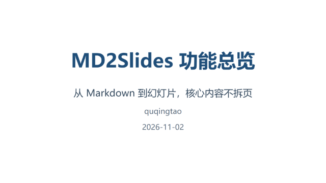
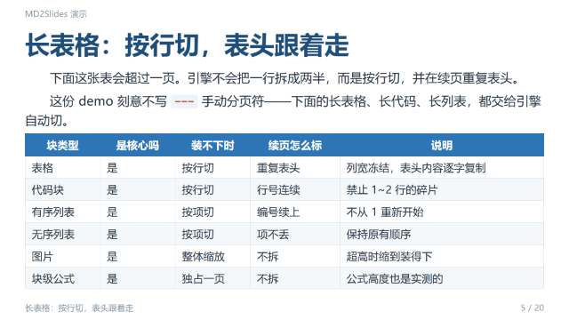
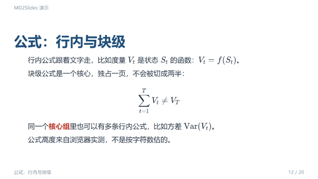

# MD2Slides

[](https://github.com/wenlanstudio/md2slides/actions/workflows/ci.yml)
[](https://wenlanstudio.github.io/md2slides/)
[](LICENSE)
[](package.json)

在线演示：**https://wenlanstudio.github.io/md2slides/**

**用 Markdown 写幻灯片，不用手动分页符**——标题自动切章，装不下时自动分割：
表格按行续（续页重复表头）、代码按行续（行号不断）、列表按项续（编号接上），
图片、表格、公式这些核心内容优先保证完整。

> An editor-independent Markdown → slides engine with heading-based logical pagination,
> browser-measured physical pagination, a frozen Slide IR, and editable PPTX export.

<table>
<tr>
<th align="left" width="46%">输入 · <code>examples/demo.md</code>（节选）</th>
<th align="left" width="54%">输出 · 自动分页出的幻灯片</th>
</tr>
<tr>
<td>

<pre><code>---
title: MD2Slides 功能总览
subtitle: 从 Markdown 到幻灯片，核心内容不拆页
author: quqingtao
date: 2026-11-02
book: MD2Slides 演示
theme: lecture
headingDivider: 2
---</code></pre>

</td>
<td></td>
</tr>
<tr>
<td>

<pre><code>## 核心组：一页一个主角

| 角色 | 例子 | 规则 |
| --- | --- | --- |
| 引导语 | 下面这张表…… | 紧贴核心前的唯一段落 |
| 核心 | 表格、代码、列表、图片、公式 | 一页最多一个核心组，可含 1~4 个核心 |
| 结束语 | 上表说明…… | 紧贴核心后的唯一段落 |

## 公式：行内与块级

块级公式是一个核心，独占一页，不会被切成两半：

$$
\sum_{t=1}^{T} V_t \neq V_T
$$</code></pre>

</td>
<td>
  
  
</td>
</tr>
</table>

完整 11 章效果见在线演示：**https://wenlanstudio.github.io/md2slides/**。

同一份输入（`examples/demo.md`，无手动分页符），四种产物点开即看：

| 产物 | 文件 | 说明 |
| --- | --- | --- |
| Markdown 输入 | [examples/demo.md](examples/demo.md) | 11 章，交给引擎自动分割 |
| 独立 HTML 放映 | [examples/demo.html](examples/demo.html) · [在线预览](https://wenlanstudio.github.io/md2slides/) | 一个文件双击可放，20 页 |
| 图片型 PPTX | [examples/demo.pptx](examples/demo.pptx) | 零依赖、所见即所得 |
| 可编辑 PPTX | [examples/demo-editable.pptx](examples/demo-editable.pptx) | PowerPoint 里可改文字与形状 |


## 为什么是 MD2Slides

常见的 Markdown 转幻灯片工具按固定规则切页：一页装不下就拦腰切，图片、表格、公式经常被拆成两半。

MD2Slides 把「这一页里什么必须在一起」建模成**核心组**：图片、表格、列表、代码块、公式是**核心**，紧贴前后的引导语/结束语是它的上下文。分页时先保证一页最多一个核心组，装不下才按块类型切——表格按行（续页重复表头）、代码按行、列表按项。

- **核心内容优先**：图片、表格、公式尽量完整，不为了填满一页被随意拆开
- **两层分页**：先按标题逻辑切页，再在浏览器里量真实高度做物理分页
- **不改源文件**：所有切分都发生在渲染产物上
- **产物可交付**：独立 HTML 放映 / 图片型或可编辑 PPTX / Slide IR
- **编辑器无关**：core 不碰编辑器，marktext 或自己的宿主都能接
- **放映与投屏**：一页一屏、键盘/触屏翻页、逐元素步进、局域网 SSE 投屏

## 快速开始

### 从仓库运行

```bash
git clone https://github.com/wenlanstudio/md2slides.git
cd md2slides
npm ci

node tools/render.js examples/demo.md -o out.html        # HTML 预览（只逻辑分页）
node tools/export-html.js examples/demo.md -o out.html   # 独立 HTML 幻灯片（完整分页 + 放映器）
node tools/export.js examples/demo.md -o deck.pptx       # 导出 PPTX（默认图片型；--editable 可编辑型）
npm test                                                 # check + smoke + e2e 三层
```

环境要求：Node.js >= 18。物理分页和 e2e 需要 Chrome / Edge（`CHROME_PATH` 可指定）；
PPTX 成品比对需要 Python + python-pptx（`MD2SLIDES_PYTHON` 可指定，缺则跳过成品段）；
PlantUML 图需要 Java 11+，jar 用 `npm run fetch:plantuml` 下载。

### 作为库使用

```bash
npm install @wenlanstudio/md2slides
```

从源码使用：在仓库根目录 `npm link`，然后：

```js
const md2slides = require("@wenlanstudio/md2slides")
```

完整接入序列见 [docs/API.md](docs/API.md)，核心是五步：

<details>
<summary>展开最小接入代码</summary>

```js
// ① 解析 + 逻辑分页 + 主题（Node 传 jsdom document，浏览器传 iframe 的 document）
const deck = md2slides.compose(mdText, { document: iframeDoc })
injectStyle(iframeDoc, deck.css + md2slides.CONT_CSS)
injectHtml(iframeDoc, deck.html)

// ② 图表预通行：core 只调度，出图的是宿主；必须在实测分页之前
await md2slides.renderDiagrams(iframeDoc, { renderDiagram: hostRenderDiagram })
md2slides.assertDiagramsRendered(iframeDoc)

// ③ 物理分页：真实布局里跑，settle 到没有新增页
for (let i = 0; i < 6; i++) {
  if (!md2slides.splitOverflow(iframeDoc, {
    slideWidth: deck.slideWidth, slideHeight: deck.slideHeight, meta: deck.meta,
  })) break
}

// ④ 切片会丢代码高亮 span，重染一次
md2slides.highlightCode(iframeDoc)

// ⑤ 要导出 PPTX 才需要：抽 IR 并过闸门
const ir = await md2slides.extractIr(iframeDoc, {
  slideWidth: deck.slideWidth, slideHeight: deck.slideHeight,
  theme: deck.theme, meta: deck.meta, media: mediaSink, rasterize: hostRasterize,
})
md2slides.checkIr(iframeDoc, ir)
```

</details>

只做预览/放映的宿主到第 ④ 步为止。另有 `checkIr`、`createDeckPlayer`、`sectionsOf`、
`beginMeasure` 等辅助；签名与运行环境矩阵见 [docs/API.md](docs/API.md)。Slide IR 是每页
「有什么、在哪、什么样式」的 JSON 契约，**v1 已冻结**。

## 三种产物

| 命令 | 产物 | 说明 |
| --- | --- | --- |
| `node tools/render.js` | HTML 预览 | 只做逻辑分页，适合快速看结构 |
| `node tools/export-html.js` | 独立 HTML 幻灯片 | 完整物理分页 + 内置放映器，一个文件双击可放 |
| `node tools/export.js` | PPTX | 默认图片型、零依赖；`--editable` 走 Python sidecar 出可编辑形状 |

## 怎么写幻灯片

- front-matter 写题名、作者、页眉页脚、关键词（如 `title` / `author` / `header` / `footer`）
- 用标题层级切逻辑页；`---` 是手动分页符
- `<!-- begin/split/end -->` 三注释做手动分栏
- 题名只写在 front-matter，正文只有标题和内容

完整写作规范见 [USAGE.md](USAGE.md)。

## 分页怎么工作

**逻辑分页**按标题层级把文档切成页，只认结构，不管装不装得下。

**物理分页**在浏览器里量真实高度，按**核心组**决定一页放什么：

- 核心 = 代码块、表格、有序/无序列表、图片、单行公式
- 核心前后紧贴的唯一段落是引导语 / 结束语
- 一页最多一个核心组；装不下时按块类型切：表格按行（续页重复表头）、代码按行（行号连续）、列表按项（续编号）
- 续页重复标题并标「（续）」；`---` 和手动分栏是冻结区，引擎不改写

原理与全部规则见 [PAGINATION.md](PAGINATION.md)。

## 宿主与集成

> Typora 宿主壳因合规评估暂时移出主仓库（代码与文档已单独备份）；本仓库当前保留
> marktext 与自定义宿主。

- **marktext deck-full**：整链 deck 页面 + 共享本地服务 + postMessage 桥。宿主侧实现在独立 fork，本仓库只含页面入口
- **自己的宿主**：实现 `renderDiagram` 等钩子即可；参考 `host/thin/`（graphviz / plantuml）与 `host/browser/`（mermaid / echarts）

core 不渲染图表、不碰编辑器；宿主专属能力全部经 opts 钩子注入。`host/` 随仓库分发，
**不进 npm 包**；npm 包只含库本体（core / kit / export / lib / types / docs）。

## 项目结构

```text
core/      引擎本体：解析、逻辑分页、物理分页、主题
kit/       播放器、手势、图片查看器
export/    Slide IR 抽取、校验闸门、PPTX sidecar
host/      宿主实现（marktext / thin / browser），不进 npm 包
lib/       vendored 运行时（KaTeX / markdown-it / highlight 等）
tools/     CLI 与构建脚本
docs/      API 契约与设计档案
```

## 测试

| 命令 | 验什么 | 要浏览器 |
| --- | --- | --- |
| `npm run check` | 静态 require 图 | 否 |
| `npm run smoke` | 解析 / 主题 / 逻辑分页 | 否 |
| `npm run test:unit` | 单元测试 | 否 |
| `npm run e2e` | 物理分页 + IR 闸门 + 真出 PPTX | 是 |

改完 `core/` 后建议跑完整 `npm test`；改 `host/` 前先 `npm run build:host`。
开发环境细节见 [CONTRIBUTING.md](CONTRIBUTING.md)。

## 已知限制

- 物理分页必须在真实浏览器里跑；`file://` 取不到字体，量出的高度不可信
- 字体和浏览器版本会影响分页与截图基线，跨环境比对前先重建基线
- PlantUML 需要 Java 11+，jar 不入库，用 `npm run fetch:plantuml` 下载
- 投屏广播绑 `0.0.0.0` 且不做访问控制，只适合可信局域网
- 可执行代码块在放映时点 ▶ 会真的在本机执行；ECharts option 用 `new Function` 求值。
  不要打开或放映来源不可信的 deck

## 文档

- [docs/API.md](docs/API.md) —— 库契约、参数表、运行环境矩阵、宿主钩子
- [USAGE.md](USAGE.md) —— 幻灯片写作规范
- [PAGINATION.md](PAGINATION.md) —— 分页原理与规则
- [CHANGELOG.md](CHANGELOG.md) —— 版本记录
- `docs/design/` —— 设计档案

## 参与

开发环境与测试命令见 [CONTRIBUTING.md](CONTRIBUTING.md)；安全问题请按
[SECURITY.md](SECURITY.md) 私密报告。

## License

MIT © quqingtao and md2slides contributors，见 [LICENSE](LICENSE)。
随仓库分发的第三方组件及许可见 [THIRD-PARTY-NOTICES.md](THIRD-PARTY-NOTICES.md)。
