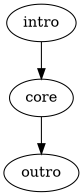
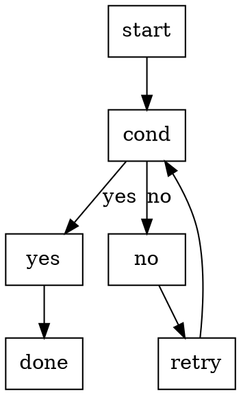
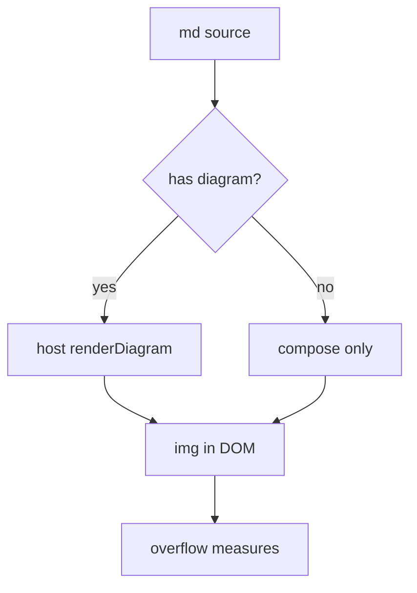
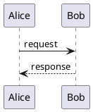

这一份专打「图表由宿主渲染」那条链路：预通行必须跑在物理分页实测之前，
这样 IR 量到的图高度才是真的。

## 一张小图



## 一张决策树



## 一张流程图（mermaid）

mermaid 是浏览器运行时，只能在页面里渲染——这一块验的就是"预通行分环境跑两遍"。



## 一张统计图（echarts）

echarts 画到 canvas 上，同样只能在页面里渲染；它直接 `getDataURL()` 出 PNG，
省掉了 SVG→PNG 那一道栅格。

```echarts
{
  "xAxis": { "type": "category", "data": ["Mon", "Tue", "Wed", "Thu", "Fri"] },
  "yAxis": { "type": "value" },
  "series": [{ "type": "bar", "data": [120, 200, 150, 80, 70] }]
}
```

## 一张时序图（plantuml）

plantuml 走 `java -jar`，跟 graphviz 一样是 Node 侧的活。



## 图后面还有正文

图表被当成「中心内容」，所以它会独占一页——后面的段落不该被挤到同一页上。
