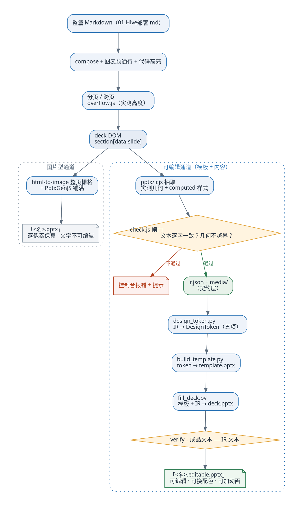
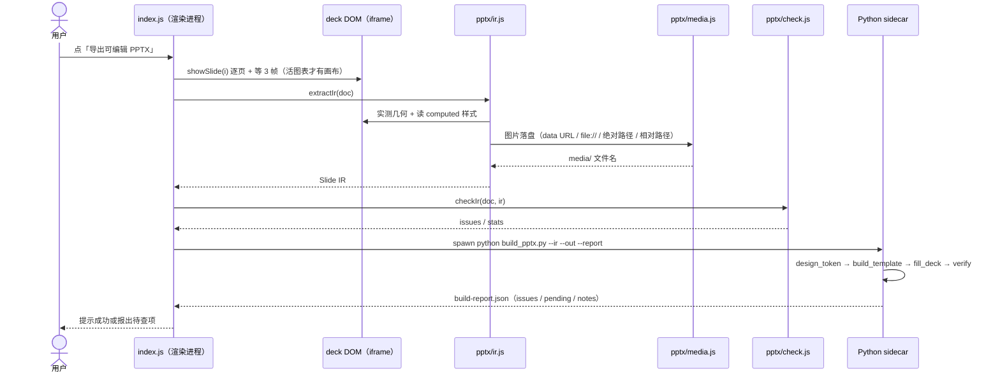
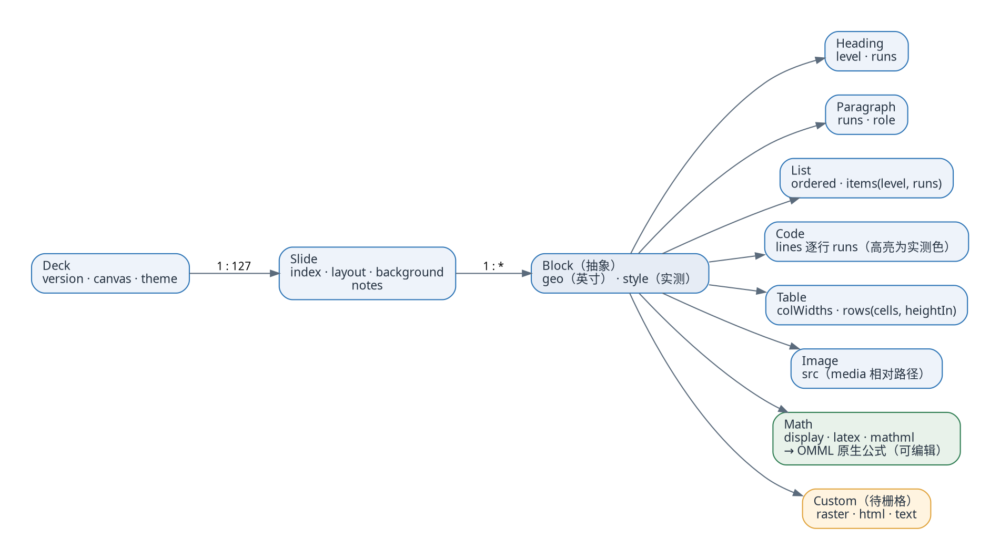
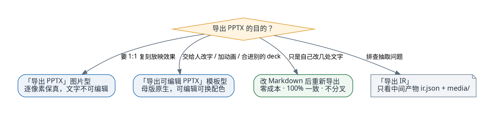

# 可编辑 PPTX 子项目 · 架构与流程

`export/pptx/` 把「整篇 Markdown 的 deck」变成**可编辑的 PPTX**。思路是**模板 + 内容**：
样式归母版（PowerPoint 原生对象），内容归 IR（从已渲染的 DOM 实测得来）。

---

## 一、管线总览

一条 deck，两条通道，差异只在后半段：图片型追求像素，可编辑型追求结构。

---

## 二、一键出片的调用时序

出片跨了**进程边界**：Electron 渲染进程负责抽取与校验，母版、版式、填充都在 Python 子进程里完成。

---

## 三、Slide IR 的结构

IR 是这条通道的**唯一契约**：一份数据结构，两侧都只对它负责
（书面、可机器校验的定义在 `ir.schema.json`）。

几何与样式的取值口径（决定"同源一致"能否成立）：

| 项 | 取值方式 |
| --- | --- |
| 位置 / 尺寸 | `getBoundingClientRect()` 实测（`beginMeasure` 钉画布后 scale=1），换成英寸 |
| 字号 / 颜色 / 对齐 / 行距 | 该元素自己的 `getComputedStyle`（不经全局 token） |
| run 级样式 | 只记录与所属块**不同**的字段；代码高亮因此是实测色 |
| 图片 | 落盘成 `media/`，IR 只留文件名 |

---

## 四、选哪条通道

一致性目标是**同源 token**，不是逐像素一致——那是两条互斥的路，先按目的选。

---

## 五、文件职责

| 文件 | 职责 |
| --- | --- |
| `pptx/ir.js` | DOM → Slide IR：实测几何、逐元素样式、块分类 |
| `pptx/media.js` | 四种来源的图片统一落盘，IR 只留文件名 |
| `pptx/check.js` | 抽取闸门：文本逐页等价（去空白比较）、几何不越界 |
| `pptx/ir.schema.json` | IR v1 契约（draft-07） |
| `sidecar/design_token.py` | IR → DesignToken：画布/背景/页码/色板/字体（众数取值） |
| `sidecar/build_template.py` | token → `template.pptx`：母版、主题色板、字体三档、8 版式、页码占位符 |
| `sidecar/fill_deck.py` | 模板 + IR → `deck.pptx`；写完回读成品再验一次 |
| `sidecar/omml.py` | 公式：MathML → OMML（Office 原生公式）；优先 Office 的 `MML2OMML.XSL`，找不到走内置兜底 |
| `sidecar/build_pptx.py` | 一键串联（模板按主题哈希缓存）+ 输出 `build-report.json` |

---

## 六、四条不可回退的约束

1. **IR 从已渲染的 DOM 抽取**，不从 Markdown 重新解析——分页、图表位图、代码高亮都已是现成结果，
   重解析等于把 marp-core 再实现一遍。
2. **内容样式走逐元素实测**，不经"全局 token → 再应用"——否则主题改一处就要重建模板。
3. **文本不按视觉行拆段**——拆段能让换行与浏览器一致，但改一个字就全乱，与可编辑性互斥。
4. **分页决策留在浏览器侧**——PPTX 侧无法预知 PowerPoint 的排版结果，在那儿算"装不装得下"必然失准。
